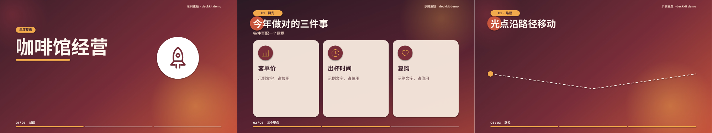
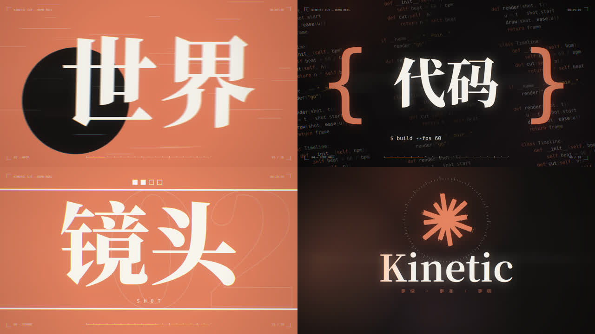
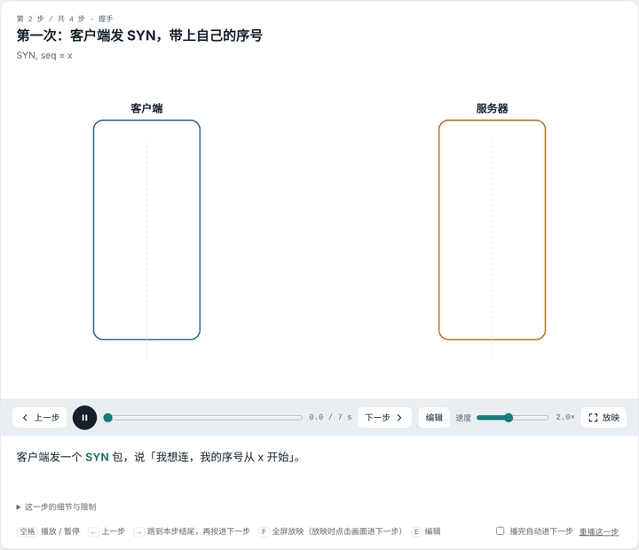

<div align="center">

# Claude Motion Skills

**让 Claude 做出会动的东西：带原生动画的 PPT、卡点快剪视频、分步讲解动画网页。**

[English](README.en.md) · 中文

  


<sub>↑ <code>kinetic-cut-video</code> 的 18 秒技法演示片（原片 1080p60，带合成配乐）。它只用来展示引擎能力；实际使用时每条片子都会按题材重新设计</sub>

</div>

---

三个 [Agent Skills](https://docs.claude.com/en/docs/agents-and-tools/agent-skills/overview)，每个都附带了**能直接跑的代码**（不是只有提示词）：

| Skill | 产出 | 一句话 |
|---|---|---|
| [`animated-native-pptx`](skills/animated-native-pptx) | `.pptx` | 文字、卡片、图标全部可编辑，每页进入后**原生动画自动依次播放**，WPS / PowerPoint 都能打开 |
| [`kinetic-cut-video`](skills/kinetic-cut-video) | `.mp4` | Canvas 引擎 + Playwright 逐帧渲染，每秒一个满屏镜头，运动模糊、辉光、色散、**代码合成配乐** |
| [`animation-html`](skills/animation-html) | `.html` | 单文件分步讲解动画：步骤条、旁白、全屏放映、翻页笔，还能**在网页上像 PPT 一样直接编辑** |

## 效果

### 🎞️ animated-native-pptx — 有动画、可编辑的 PPT



- 渐变背景、圆角卡片、线条图标都由脚本生成，主题配色每次按内容现定
- 上浮、滑入、缩放、擦除、强调脉冲、**沿路径移动**；还能嵌自动播放的背景音乐
- 动画是写进 PPT XML 的 `<p:timing>`，不是视频——用户之后照样能改字
- 示例文件：[`examples/deckkit-demo.pptx`](https://github.com/wmzspace/claude-motion-skills/releases/download/v1.0.0/deckkit-demo.pptx)（下载后放映看动画）

### 🎬 kinetic-cut-video — 卡点快剪动效视频



- 先抽创意方向、找题材母题，再写分镜：镜头、运镜、转场、配色、字体、配乐每次都从题材长出来，并用「换皮测试」防止套模版
- 引擎提供镜头冲击、运动模糊、辉光色散和绘图零件（描线、噪声、错峰、遮罩、任意形状粒子聚合），另附 20+ 个可改造的镜头配方
- 画面是时间的纯函数 → 可**多进程并行渲染、断点续渲**；2 分钟出一版低帧率预览，并自动出质检报告（镜头时长是否单一、静止时长、明暗与色相变化、切点有没有音频落点）
- numpy 合成器按镜头表生成配乐，鼓点和切点对齐；有拨弦、合成器主音、808 低音、黑胶噪声等音色和多种调式、节奏型
- 中文、英文、中英混排都能直接做逐字动画，长英文自动限宽、可断行
- 适合片头、自我介绍、产品发布、年会暖场

### 📽️ animation-html — 分步讲解动画网页



- 一步只讲一件事：标题 + 要点 + SVG 画面 + 随时间切换的旁白 + 「细节与出处」
- 空格暂停、方向键跳步、`F` 全屏放映、翻页笔可用、明暗主题自动适配
- 按 `E` 进入网页编辑器：拖动元素、改字、加图形，`Ctrl+S` 写回 HTML
- 示例：[`examples/tcp-handshake_animation.html`](examples/tcp-handshake_animation.html)（下载后用浏览器打开）

## 安装

### Claude Code（推荐，一次装好三个）

```text
/plugin marketplace add wmzspace/claude-motion-skills
/plugin install tweenkit@claude-motion-skills
```

装好后直接说「帮我做一个有动画的汇报 PPT」「做个 20 秒的炫酷自我介绍视频」「用动画解释一下这个训练流程」，Claude 会自动调用对应 skill；也可以显式输入 `/tweenkit:animation-html <主题>`。

### 手动安装

```bash
git clone https://github.com/wmzspace/claude-motion-skills.git
cp -r claude-motion-skills/skills/* ~/.claude/skills/        # 个人级
# 或 cp -r claude-motion-skills/skills/* <项目>/.claude/skills/   # 项目级
```

### Claude.ai / Claude 桌面端

把单个 skill 文件夹打包成 zip，在设置的 Skills 页面上传：

```bash
cd claude-motion-skills/skills && zip -r animation-html.zip animation-html
```

> `SKILL.md` 是普通 Markdown + 脚本，其他支持 Agent Skills 格式的编程智能体也能用。

## 依赖

| Skill | 需要 |
|---|---|
| animated-native-pptx | `python3`（`python-pptx` `Pillow` `lxml`）、`node` + `playwright`；检查环节用 LibreOffice、`pdftoppm`、`ffmpeg` |
| kinetic-cut-video | `node` + `playwright`（Chromium）、`ffmpeg`、`python3` + `numpy`、带粗字重的中文字体（如 Noto CJK） |
| animation-html | 只需浏览器；自检截图用 `playwright` |

```bash
pip install python-pptx pillow lxml numpy
npm i -g playwright && npx playwright install chromium   # 已装有 Chromium 可跳过第二步
```

## 自己动手跑一下

```bash
# PPT：3 页示例
cd skills/animated-native-pptx/scripts
cp theme.example.json theme.json
NODE_PATH=$(npm root -g) node assets.js && python3 demo.py      # → demo.pptx

# 视频：渲染 18 秒技法演示片（在原目录渲染，输出已被 .gitignore 忽略）
python3 skills/kinetic-cut-video/scripts/build.py skills/kinetic-cut-video/examples/showreel stills   # 先抽帧预览
python3 skills/kinetic-cut-video/scripts/build.py skills/kinetic-cut-video/examples/showreel render   # → out.mp4

# 抽一组创意方向（三个 skill 各有一个 brief.py）
python3 skills/kinetic-cut-video/scripts/brief.py "电子科技大学 20 秒介绍"
```

## 目录结构

```text
claude-motion-skills/
├── .claude-plugin/          # Claude Code 插件市场配置
├── skills/
│   ├── animated-native-pptx/
│   │   ├── SKILL.md
│   │   └── scripts/         # deckkit.py 工具库、assets.js 背景/图标渲染、demo.py、brief.py
│   ├── kinetic-cut-video/
│   │   ├── SKILL.md
│   │   ├── assets/template/ # 新工程起点：engine.js 引擎 + 空骨架 index.html / audio.py
│   │   ├── examples/showreel/ # 技法演示片（只用来查 API）
│   │   ├── references/      # motif-method.md 母题方法、fx-api.md 函数速查
│   │   └── scripts/         # render.mjs、build.py、audio_lib.py、brief.py
│   └── animation-html/
│       ├── SKILL.md
│       ├── assets/template.html
│       └── scripts/brief.py
├── examples/                # 示例产物
└── docs/images/             # README 用图
```

## 设计原则

这三个 skill 共享几条约束，也是它们产出质量稳定的原因：

- **工具代码管「怎么摆、怎么动」，不管「长什么样」**：画面、版式、动效、运镜、配色、字体、配乐、文案每次从内容重新设计。
- **防套模版**：先用 `brief.py` 抽创意方向打破惯性，再从题材里找母题；示例只用来查 API，交付前做「换皮测试」——把文案换成另一个题材，画面还成立就说明是模版，要重做。
- **不编数据**：没给的数字用 `[占位]` 或 `UNKNOWN`，交付时列清哪些是原文、哪些是补的。
- **交付前必须自检**：PPT 转 PDF 拼图看溢出，视频先抽帧联系表，网页逐步截图并测放映模式。
- **如实说明局限**：原生 PPT 动画做不到逐字弹入；配乐是代码合成的、需要人耳确认。

## 参与

欢迎 Issue 和 PR：新的镜头技法、PPT 版式、图标，或者你用这些 skill 做出来的作品。

如果它帮你省了时间，点个 ⭐ 吧。

## License

[MIT](LICENSE)
